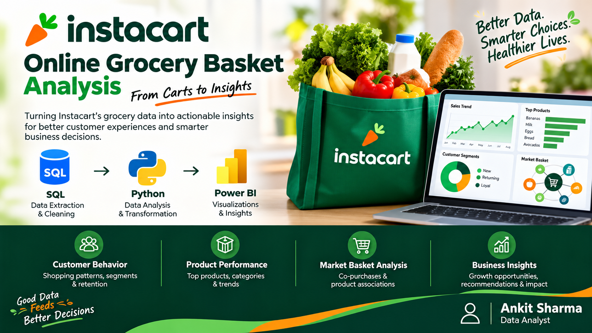
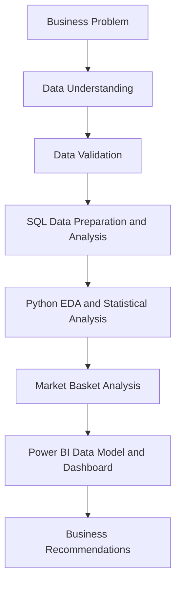

# Instacart Online Grocery Basket Analysis



An end-to-end grocery analytics portfolio project using **PostgreSQL, Python, and Power BI** to analyze ordering behavior, reorders, customer frequency, product and department performance, and product-pair associations. The workflow emphasizes data validation, analytical integrity, and reconciliation from source data through the final dashboard.

## Project Overview

**Business Objective:** Convert historical grocery-order data into validated insights about repeat purchasing, basket behavior, category performance, and product associations.

**Business Questions**

- What are the analyzed order, customer, and item volumes?
- What share of item purchases are reorders?
- How do customer frequency and reorder behavior vary?
- Which products, aisles, and departments have the highest purchase volumes?
- Which product pairs appear together in orders?
- What practical experiments can be proposed from the findings?

## Dashboard Preview

### 01 — Executive Overview


Core KPIs, order behavior, basket size, and overall reorder performance.

### 02 — Customer Behavior


Customer frequency and behavioral segments based on observed order and reorder patterns.

### 03 — Product & Department Performance


Product, aisle, and department purchase volume and reorder performance.

### 04 — Market Basket & Recommendations


Product-pair associations evaluated using support, confidence, lift, and minimum pair-order controls.

### 05 — Business Recommendations


Business actions tied to validated findings. The project has four core analytical Power BI pages plus a dedicated Business Recommendations visual/asset. 

## Data Model


## Dataset

- **Source:** [Instacart Online Grocery Basket Analysis Dataset](https://www.kaggle.com/datasets/yasserh/instacart-online-grocery-basket-analysis-dataset)
- **Dataset author:** `yasserh`
- **Source format:** CSV
- **Raw source files:** 6

| File | Source Rows | Description |
|---|---:|---|
| `aisles.csv` | 134 | Aisle lookup |
| `departments.csv` | 21 | Department lookup |
| `products.csv` | 49,688 | Product catalog |
| `orders.csv` | 3,421,083 | Order-level information |
| `order_products__prior.csv` | 32,434,489 | Prior order-product records |
| `order_products__train.csv` | 1,384,617 | Training/reference order-product records |

The source `orders` table contains `eval_set` values `prior`, `train`, and `test`.

### Analysis Scope

- **PRIOR** is the primary historical analysis set.
- **TRAIN** is retained for reference and validation.
- **TEST** is not treated as completed historical transactions.
- The source catalog contains **49,688 products**; **49,677 products** appear in analyzed PRIOR purchases.
- `missing` is a legitimate source department category and is preserved without renaming, deletion, or reassignment.

### Limitations

The source does not support revenue/profit analysis, demographic analysis, conventional monetary RFM, confirmed customer churn, or confirmed inventory stockouts. These are not claimed as findings.

## Architecture and Workflow



| Stage | Purpose | Main Artifacts |
|---|---|---|
| Business Problem | Define business questions and decision context | Project scope and business questions |
| Data Understanding | Review source tables, fields, and relationships | `raw data/README.md`, `docs/data_dictionary.md` |
| Data Validation | Validate keys, mappings, row counts, and source semantics | `SQL/03_source_constraints_and_qa.sql` |
| SQL Data Preparation & Analysis | Build controlled clean and analytical layers | `SQL/01` through `SQL/07` |
| Python EDA & Statistical Analysis | Profile behavior, validate SQL outputs, and create analytical outputs | `Python/Python eda.py` |
| Market Basket Analysis | Evaluate product associations in a controlled universe | `market_basket_associations.csv` |
| Power BI Data Model & Dashboard | Model validated outputs and publish governed KPIs | `Power BI/Instacart Analytics.pbix` |
| Business Recommendations | Translate observed patterns into testable actions | `docs/business_recommendations.md` |

## Technology Stack

| Technology | Purpose |
|---|---|
| PostgreSQL | Source, clean, and analytical data layers; SQL validation |
| Python | EDA, analytical checks, reconciliation, and market basket analysis |
| Pandas | Data manipulation and validation |
| NumPy | Numerical processing |
| Matplotlib | Charts and visual analysis |
| SciPy | Statistical and analytical calculations |
| psycopg2-binary | PostgreSQL connectivity |
| Power BI Desktop | Data modeling and dashboards |
| DAX | Governed KPI measures |
| Git and GitHub | Version control and portfolio publishing |

Production Python dependencies are listed in `requirements.txt`.

## Data Preparation and SQL

### Source Tables

- `public.aisles`
- `public.departments`
- `public.products`
- `public.orders`
- `public.order_products__prior`
- `public.order_products__train`

### Clean Layer

Schema: `analytics`

- `clean_aisles`
- `clean_departments`
- `clean_products`
- `clean_orders`
- `clean_order_products_prior`
- `clean_order_products_train`

### Cleaning Decisions

- Trim text values.
- Convert blank text to `NULL`.
- Normalize `eval_set` using lower/trim logic.
- Preserve valid NULLs, including first-order `days_since_prior_order`.
- Do not delete rows merely because values are missing.
- Preserve source hierarchy keys and mappings.
- Retain the legitimate `missing` department category; do not rename, delete, or reassign it.

### Analytical Layer

Principal analytical objects include:

- `enriched_order_product_prior`
- `order_basket_summary`
- `reorder_summary`
- `orders_by_day`
- `orders_by_hour`
- `orders_by_day_hour`
- `basket_size_distribution`
- `reorder_by_sequence`
- `product_performance`
- `department_performance`
- `aisle_performance`
- `customer_behavior`
- `customer_frequency`
- `customer_purchase_gap_distribution`
- `market_basket_product_universe`

### SQL Execution Order

1. `SQL/01_create_source_tables.sql`
2. `SQL/02_load_source_data.sql`
3. `SQL/03_source_constraints_and_qa.sql`
4. `SQL/04_controlled_sql_cleaning.sql`
5. `SQL/05_clean_layer_qa.sql`
6. `SQL/06_analytical_layer.sql`
7. `SQL/07_analytical_qa_and_reconciliation.sql`

The investigation of the `missing` department is retained in `SQL/archive/`.

## Python EDA and Validation

**Production script:** `Python/Python eda.py`

The workflow validates analytical object contracts, profiles customer/order/product/department/time behavior, reconciles Python outputs against SQL, performs market basket analysis, and writes charts, CSV outputs, reports, and validation manifests.

### Recorded Validation Results

| Validation | Result |
|---|---|
| SQL analytical object validation | PASS |
| SQL ↔ Python reconciliation | 23 checks, 0 failures |
| Python analytical validation | 27 checks, 0 failures |
| Customer segment reconciliation | PASS |
| Market basket regression checks | PASS |
| Overall Python status | PASS |

## Market Basket Analysis

The analysis uses a controlled **top-100 product universe**.

| Control | Validated Value |
|---|---:|
| Product universe | 100 |
| Minimum pair orders | 100 |
| Maximum association output | 500 rows |
| Analytical rows streamed | 7,483,881 |
| Qualifying product pairs | 4,945 |

### Metrics

**Support**

`Support(A,B) = orders containing both A and B / total analyzed orders`

**Confidence**

`Confidence(A → B) = Support(A,B) / Support(A)`

**Lift**

`Lift(A → B) = Confidence(A → B) / Support(B)`

Pair counts represent distinct orders containing both products. Output is limited to the configured maximum of 500 associations.

**Interpretation rule:** Association does not establish causation. These results identify hypotheses for recommendation or merchandising experiments, not proof that one product causes another purchase.

## Power BI Data Model and DAX

Validated clean and analytical PostgreSQL outputs were loaded into Power BI rather than raw public source tables.

### Main Dimensions

- `DimCustomer`
- `DimProduct`
- `DimAisle`
- `DimDepartment`
- `DimOrderDay`
- `DimOrderHour`

### Main Fact Tables

- `FactCustomerBehavior`
- `FactOrderBehavior`
- `FactProductPerformance`
- `FactDepartmentPerformance`
- `FactAislePerformance`
- `FactBasketAssociation`

Additional analytical outputs are included where required by the dashboard.

### DAX KPI Layer

A dedicated `_Measures` table centralizes governed measures and display folders.

| Measure | Definition / Purpose |
|---|---|
| Total Orders | Total analyzed PRIOR orders |
| Total Customers | Customers represented in the analysis |
| Total Items | Analyzed product-line items |
| Reordered Items | Items marked as reordered |
| First-Time Items | Items not marked as reordered |
| Reorder Rate | Reordered items ÷ total items |
| Average Basket Size | Total items ÷ total orders |

### Reconciled KPI Controls

| KPI | Validated Value |
|---|---:|
| Total Orders | 3,214,874 |
| Total Customers | 206,209 |
| Total Items | 32,434,489 |
| Reordered Items | 19,126,536 |
| First-Time Items | 13,307,953 |
| Overall Reorder Rate | 58.97% |
| Average Basket Size | 10.09 |

## Validated Findings

### Executive KPIs

- **Orders:** 3,214,874
- **Customers:** 206,209
- **Item purchases:** 32,434,489
- **Reordered items:** 19,126,536
- **First-time items:** 13,307,953
- **Overall reorder rate:** 58.97%
- **Average basket size:** 10.09 items
- **Purchased products:** 49,677

### Customer Behavior

The high-frequency/high-reorder segment contains **49,610 customers**, approximately **24.06%** of analyzed customers.

### Department Performance

- **Produce:** 9,479,291 purchases
- **Dairy Eggs:** 5,414,016 purchases
- **Dairy Eggs reorder rate:** 67.00%

### Market Basket Association

The strongest validated observed pair is **Sparkling Lemon Water + Lime Sparkling Water**:

- **Orders together:** 8,546
- **Lift:** 18.0024

### Purchase Gap

The weighted average purchase gap, excluding first-order records without a previous interval, is **10.71 days**.

## Business Recommendations

### 1. Replenishment and Reorder Experience

**Finding:** Overall reorder rate is **58.97%**.

**Action:** Test reorder shortcuts and replenishment reminders for products customers repeatedly purchase.

**KPIs:** Reorder rate and repeat-order rate.

This is a replenishment opportunity, not a churn-prevention metric.

### 2. High-Frequency / High-Reorder Customers

**Finding:** **49,610 customers / approximately 24.06%**.

**Actions:**

- Test personalized reorder shortcuts.
- Test relevant product recommendations.
- Test loyalty-oriented experiences.

**KPIs:** Orders per customer and reorder rate.

### 3. Department Prioritization

**Finding:**

- Produce: **9,479,291 purchases**
- Dairy Eggs: **5,414,016 purchases**
- Dairy Eggs reorder rate: **67.00%**

**Action:** Prioritize these categories for availability, replenishment planning, and merchandising attention.

**KPIs:** Purchase volume and reorder rate.

The analysis does **not** establish actual stockouts.

### 4. Basket Recommendation Opportunity

**Finding:** Sparkling Lemon Water + Lime Sparkling Water appeared together in **8,546 orders**, with lift **18.0024**.

**Action:** Test cart recommendations, complementary product placement, or bundle experiments.

**KPIs:** Pair attach rate and recommendation conversion.

Association does not prove causation.

## QA Framework

| Checkpoint | Status |
|---|---|
| Source QA | PASS |
| Clean-layer QA | PASS |
| SQL analytical QA | PASS |
| SQL ↔ Python reconciliation | PASS |
| Python analytical validation | PASS |
| Power BI model QA | PASS |
| DAX QA | PASS |
| Final dashboard QA | PASS |

These checks are intended to keep core results consistent from source data through SQL, Python, Power BI, and DAX.

## Project Outputs

All Python-generated outputs are organized under `outputs/Python_eda_v2/`.

### CSV Outputs

- `executive_kpis.csv`
- `department_performance.csv`
- `orders_by_day.csv`
- `orders_by_hour.csv`
- `reorder_summary.csv`
- `customer_behavioral_segment_summary.csv`
- `market_basket_associations.csv`

### Reports and Validation Outputs

- `business_highlights.csv`
- `final_python_analytical_validation.csv`
- `methodology_controls.csv`
- `sql_analytical_object_validation.csv`
- `sql_python_cross_validation.csv`
- `python_analytical_missingness.csv`
- `run_manifest.csv`

### Charts

- `customer_behavior_segments.png`
- `customer_order_frequency.png`
- `department_purchase_count.png`
- `department_reorder_rate.png`
- `market_basket_top_lift.png`
- `orders_by_day.png`
- `orders_by_hour.png`
- `top_20_aisles.png`
- `top_20_products.png`

## Repository Structure

```text
Instacart Online Grocery Basket Analysis/
├── README.md
├── .gitignore
├── requirements.txt
├── assets/
│   ├── banner/
│   │   └── project_banner.png
│   ├── dashboard/
│   │   ├── 01 — Executive Overview.png
│   │   ├── 02 — Customer Behavior.png
│   │   ├── 03 — Product & Department Performance.png
│   │   ├── 04 — Market Basket & Recommendations.png
│   │   └── 05 — Business Recommendations.png
│   └── diagrams/
│       └── 00_Data model.png
├── raw data/
│   ├── aisles.csv
│   ├── departments.csv
│   ├── order_products__prior.csv
│   ├── order_products__train.csv
│   ├── orders.csv
│   ├── products.csv
│   └── README.md
├── SQL/
│   ├── 01_create_source_tables.sql
│   ├── 02_load_source_data.sql
│   ├── 03_source_constraints_and_qa.sql
│   ├── 04_controlled_sql_cleaning.sql
│   ├── 05_clean_layer_qa.sql
│   ├── 06_analytical_layer.sql
│   ├── 07_analytical_qa_and_reconciliation.sql
│   └── archive/
│       └── 08_Prove whether missing is an actual source department.sql
├── Python/
│   └── Python eda.py
├── src/
│   ├── data/
│   ├── features/
│   ├── analysis/
│   └── visualization/
├── Power BI/
│   └── Instacart Analytics.pbix
│   
├── outputs/
│   └── Python_eda_v2/
│       ├── charts/
│       ├── reports/
│       └── csv/
└── docs/
    ├── data_dictionary.md
    ├── data_quality_report.md
    ├── kpi_definitions.md
    ├── methodology.md
    └── business_recommendations.md
```

## Reproducing the Workflow

1. Install PostgreSQL and create the project database.
2. Create source tables and load the six CSV files.
3. Run Source QA.
4. Build the controlled clean layer.
5. Run Clean-Layer QA.
6. Build the analytical SQL layer.
7. Run SQL analytical QA and reconciliation.
8. Install Python dependencies.
9. Run `Python/Python eda.py`.
10. Review generated outputs and validation reports.
11. Open the Power BI project and connect to validated PostgreSQL tables.
12. Validate the Power BI model and DAX KPIs.
13. Review the dashboard and business recommendations.

**Prerequisites:** PostgreSQL, Python, Power BI Desktop, Git, the six source CSV files, and packages listed in `requirements.txt`.

Raw CSVs and the Power BI `.pbix` may be large. Check GitHub repository limits and consider Git LFS if needed. Never commit passwords, database credentials, API keys, or machine-specific paths.

## Documentation

- [`raw data/README.md`](raw%20data/README.md) — raw dataset notes and source details
- [`docs/data_dictionary.md`](docs/data_dictionary.md) — field and table definitions
- [`docs/data_quality_report.md`](docs/data_quality_report.md) — validation checks and outcomes
- [`docs/kpi_definitions.md`](docs/kpi_definitions.md) — KPI formulas and interpretation
- [`docs/methodology.md`](docs/methodology.md) — end-to-end methodology
- [`docs/business_recommendations.md`](docs/business_recommendations.md) — finding-linked actions

## Skills Demonstrated

Business problem framing, PostgreSQL, SQL preparation and QA, data cleaning, analytical modeling, Python EDA, SQL ↔ Python reconciliation, customer behavior analysis, product/department analysis, market basket analysis, support/confidence/lift interpretation, Power BI modeling, DAX, dashboard QA, business recommendations, and Git/GitHub organization.

## Future Improvements

Potential future work includes deeper temporal analysis, further recommendation-ranking experiments, expanded association-rule experimentation, and automated data-quality execution. These are future opportunities, not completed deliverables.

## Author

**Ankit Sharma**  
Data Analyst   
LinkedIn: [linkedin.com/in/ankit-sharma-DA](https://www.linkedin.com/in/ankit-sharma-DA)

Gmail: [ankitsharma74an@gmail.com](https://myaccount.google.com/email?continue=https%3A%2F%2Fmyaccount.google.com%2Fpersonal-info%3Futm_source%3DOGB%26utm_medium%3Dact%26hl%3Den_GB)

## License and Dataset Attribution

This project uses the publicly available [Instacart Online Grocery Basket Analysis dataset](https://www.kaggle.com/datasets/yasserh/instacart-online-grocery-basket-analysis-dataset). The original dataset license and usage terms remain applicable to the source data. Review those terms before redistributing raw CSV files.

## Analytical Integrity Statement

The reported values are based on the validated PostgreSQL analytical layer, checked through Python, and reconciled with Power BI/DAX controls. No unsupported revenue, profit, demographic, churn, stockout, or causal claims are presented as facts.
